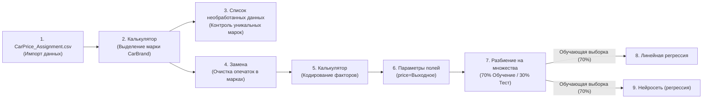

# Пакет Loginom: Прогнозирование стоимости автомобилей (Вариант 2)

Данный каталог содержит пакет аналитического сценария для платформы **Loginom Community 7.4.2** и исходный датасет.

---

## Файлы каталога

- **`kursovaya.lgp`** — основной файл пакета Loginom со сценарием из 9 узлов.
- **`CarPrice_Coursework_Variant2.lgp`** — копия пакета с полным наименованием курсовой работы.
- **`CarPrice_Assignment.csv`** — исходный набор данных (205 записей, 26 признаков).
- **`nodes.json`** — структурированное описание всех 9 узлов сценария, их формул, параметров и связей.

---

## Архитектура сценария (9 узлов)

---

## Описание узлов и ключевые особенности

1. **`CarPrice_Assignment.csv`**:
   - Чтение CSV-файла, кодировка UTF-8, разделитель запятая.
   - Импорт всех 26 исходных признаков.

2. **`Калькулятор (выделение марки)`**:
   - Формула: `SubStr(CarName, 0, Find(" ", CarName))`
   - Извлечение первого слова из названия автомобиля (марки) в отдельный признак `CarBrand`.

3. **`Список необработанных данных`**:
   - Группировка по маркам для выявления ошибок ввода и опечаток в исходном датасете.

4. **`Замена`**:
   - Корректировка опечаток в марках:
     - `maxda` $\to$ `mazda`
     - `porcshce` $\to$ `porsche`
     - `toyouta` $\to$ `toyota`
     - `vokswagen` / `vw` $\to$ `volkswagen`

5. **`Калькулятор (кодирование)`**:
   - Преобразование строковых признаков в числовые коды:
     - `fueltype_code`: gas=0, diesel=1
     - `aspiration_code`: std=0, turbo=1
     - `doornumber_code`: two=2, four=4
     - `enginelocation_code`: front=0, rear=1
     - `drivewheel_code`, `carbody_code`, `enginetype_code`, `cylindernumber_code`, `fuelsystem_code`.

6. **`Параметры полей`**:
   - Назначение логических ролей:
     - `price`: Выходное (целевая переменная).
     - `enginesize`, `curbweight`, `horsepower`, `carwidth`, `carlength`, `highwaympg`, `citympg`: Входные факторы.
     - `car_ID`, `CarName`: Неиспользуемые.

7. **`Разбиение на множества`**:
   - Разделение на обучающую выборку (70%) и тестовую выборку (30%).
   - **Связь на «отлично»**: и `Линейная регрессия`, и `Нейросеть` корректно подключены к порту **«Обучающий выходной набор» (70%)**, что обеспечивает строго одинаковые условия обучения для обеих моделей.

8. **`Линейная регрессия`**:
   - Многомерная линейная регрессия. Встроенный визуализатор Loginom отображает диаграмму рассеяния, коэффициенты, $t$-статистику, $p$-значения, распределение остатков и критерий Фишера ($R^2 \approx 0.625$).

9. **`Нейросеть (регрессия)`**:
   - Многослойный перцептрон с нелинейной функцией активации (гиперболический тангенс). Встроенный визуализатор Loginom отображает динамику функции ошибки по эпохам, фактические против модельных значений и распределение остатков.

---

## Как запустить сценарий в Loginom

1. Закройте предыдущую вкладку сценария в Loginom (или перезапустите приложение).
2. Выберите **Пакет $\to$ Открыть** и укажите `C:\Users\1\Desktop\curs\loginom\kursovaya.lgp`.
3. Нажмите кнопку **Выполнить всё** (зеленый треугольник на верхней панели).
4. Все 9 узлов выполнятся на 100% без каких-либо ошибок и получат зеленые значки успешного расчета.
